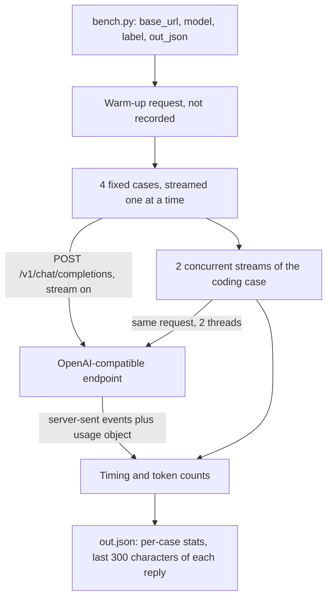

# kodros-openai-endpoint-bench

A single-file Python script that benchmarks a streaming OpenAI-compatible chat endpoint. Use it to compare models or serving stacks on the same prompts.

Part of the [Kodros](https://kodros.ai) local AI tooling.

## On your hardware

- Does: measures how fast an endpoint you host streams replies: time to first token, prefill speed, decode speed and two-stream throughput.
- Needs: Python 3 on any machine. The GPU and VRAM in play belong to the server under test, not to this script.
- Stays on-prem: it sends requests only to the base URL you give it and makes no other network calls. Point it at a local address to keep everything on your network.
- Models: it sends whatever model name you pass. One built-in prompt is in Chinese, to catch mangled multilingual output.

## How it works



Static diagram: [docs/architecture.svg](docs/architecture.svg). Step-by-step build: [BUILD.md](BUILD.md).

The four prompts are a short arithmetic question, a short coding task, a Chinese-language question and a 32,000-character long-context prompt. The script sends each one with streaming on, then runs the coding prompt on two threads. Per case it records:

- time to first token (TTFT)
- prefill tokens per second, which is prompt tokens divided by TTFT
- decode tokens per second
- wall time
- the count of U+FFFD replacement characters in the streamed text, which flags mangled multilingual output

TTFT runs from sending the request to the first non-empty content or reasoning delta. Decode speed is completion tokens divided by the time from the first token to the end of the stream. Reasoning deltas (`reasoning_content` or `reasoning`) count as output.

## Stack

Python 3, standard library only.

## Run

```bash
python3 bench.py http://127.0.0.1:8000 my-model run-a out.json
python3 -m unittest discover -s tests -v
```

Arguments in order: `base_url` (the server root; the script adds `/v1/chat/completions`), `model`, `label` (stored in the result), `out_json`. Options:

| Option | Default | Meaning |
| --- | --- | --- |
| `--timeout SECONDS` | `900` | Per-request timeout |
| `--api-key-env NAME` | none | Read a bearer token from the environment variable `NAME` |

Sampling is fixed: temperature 1.0, top_p 0.95, seed 7. Max tokens are 2048 for arithmetic and coding, 1024 for Chinese, 512 for long prefill and 1024 per concurrent stream. Edit `CASES` in `bench.py` to change them. Exit code is 0 on success, 1 when the endpoint is unreachable or returns an HTTP error, and 2 for bad arguments.

## Limits

- Each case runs once. There is no repetition, averaging or percentile reporting.
- Token counts come from the server's `usage` field, not a local tokenizer. The endpoint must return `usage` when `stream_options.include_usage` is set (vLLM and the llama.cpp server do). Without it, counts and rates read 0.
- The concurrency test uses two streams.
- The tests run against a local mock server and cover parsing, the U+FFFD count, the auth header and error exits. The script has not been checked against every server.

## License

Copyright 2026 Tanner Osterkamp. All rights reserved. See [LICENSE](LICENSE). The source is public to read; ask before reuse.
